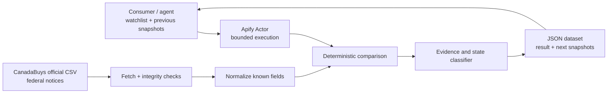
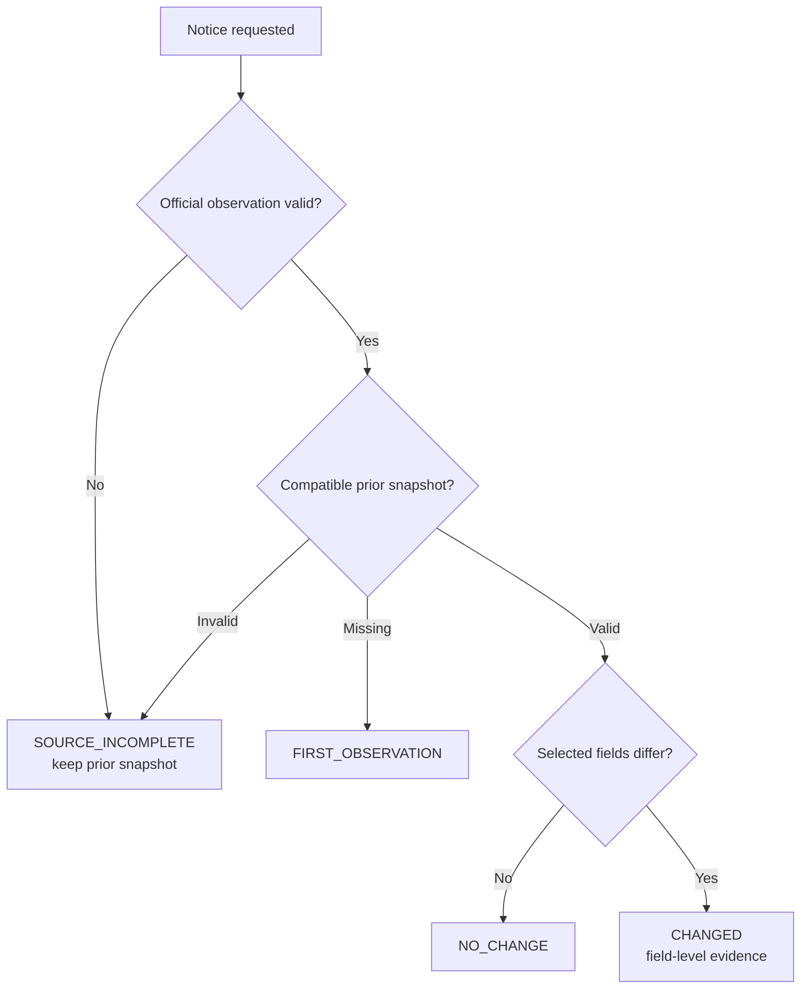

# Architecture (proposed, not implemented)

## Core boundary

The product transforms a **known notice's previously observed structured fields** and the latest official observation into a deterministic comparison. It does not interpret tender attachments, generate bids, or infer whether a supplier must act.

### Source selection

The [Open notices CSV](https://canadabuys.canada.ca/opendata/pub/openTenderNotice-ouvertAvisAppelOffres.csv) reflects currently open federal notices. The [complete CSV](https://canadabuys.canada.ca/opendata/pub/tenderNoticeComplete-avisAppelOffresComplet.csv) includes closed/cancelled/expired records too; it is needed to avoid interpreting a notice's absence from the open set as a cancellation.

**Pre-implementation validation:** confirm actual identifier, status and date column names against the [official data dictionary](https://donnees-data.tpsgc-pwgsc.gc.ca/ba2/ac-cb/achatscanada-canadabuys-dd.xml), inspect real file sizes/encoding, determine if a bounded lookup against the complete feed is economical, and document source update time availability. Field names in examples are normalized concepts, not claims about CSV headers.

### Deterministic pipeline

1. Validate watchlist size, ID syntax and previous snapshot schema compatibility.
2. Fetch an official source snapshot with HTTP integrity checks and bounded retries; do not rely on a `200` status alone.
3. Validate the CSV header, required columns, row uniqueness and parse completeness; distinguish genuine missing records from source failures.
4. Normalize only agreed field types (official dates/status/title), preserving original values in evidence.
5. Compare current with caller-supplied previous values; return a complete result for each notice.
6. Emit a clear incompleteness status if anything essential cannot be established.

### State machine

Every result has `status`, `verification`, and `observedAt`. An ambiguous source is not reported as stable. A priority hint is advisory only.

### Nonfunctional budgets (to measure, not assume)

- Default watchlist maximum: 50 notice IDs per call.
- No LLM, paid proxy, database server or custom MCP endpoint in MVP.
- Test streaming CSV parsing, memory and run duration against actual official feed sizes.
- Future source caching must respect publisher update frequency; do not claim live monitoring.
- Avoid collecting or republishing personal contact fields.
- Treat upstream data as untrusted; bound input size, network timeouts and output size.

### Test seam

Keep fetch, normalize, compare and report as separate functions with offline fixtures. Source conformance tests must detect format changes before a paid user consumes an invalid result. See [validation](validation.md).

## Official references

- https://open.canada.ca/data/en/dataset/6abd20d4-7a1c-4b38-baa2-9525d0bb2fd2
- https://donnees-data.tpsgc-pwgsc.gc.ca/ba2/ac-cb/soutien-support-eng.html
